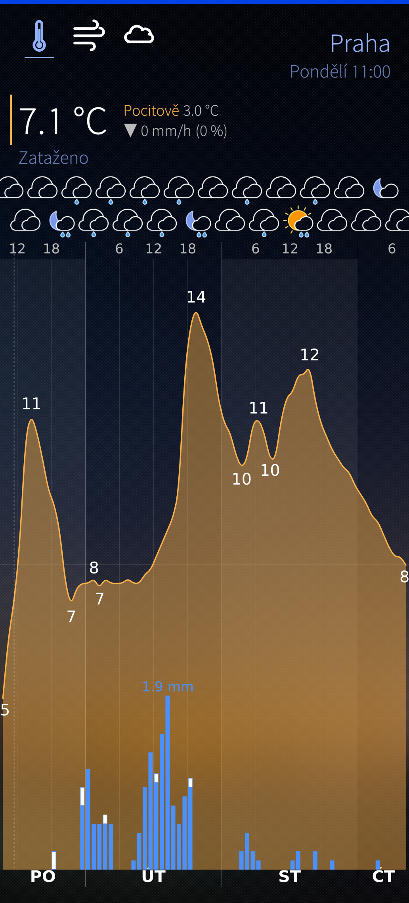
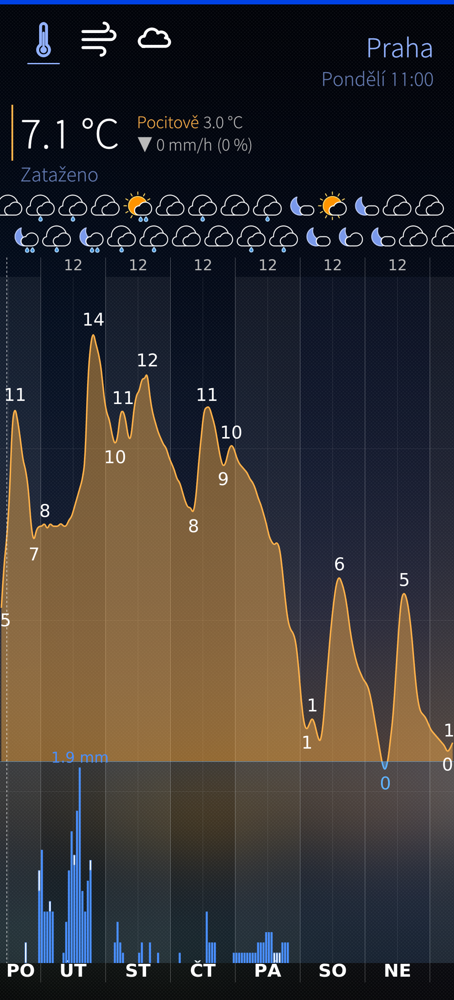
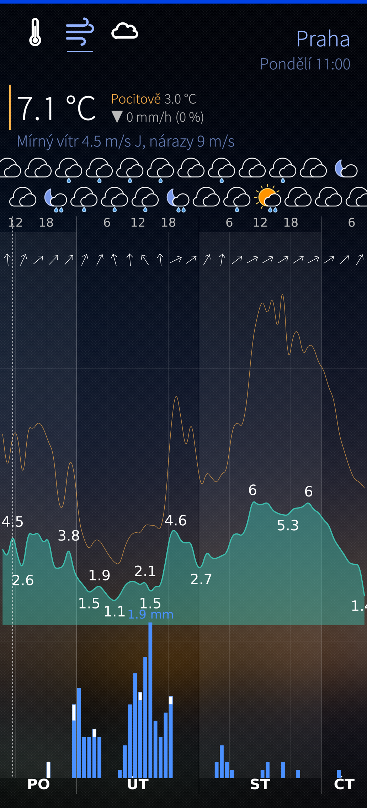

# Weather Chart (harbour-weatherchart)

Sailfish OS app that displays the weather forecast as a chart, modelled on the
Android app **Klara** (org.androworks.klara). Pure QML (noarch RPM),
no C++ code, data from **Open-Meteo**.

## Screenshots

| 3-day temperature | 7-day temperature | Wind |
|---|---|---|
|  |  |  |

## Features

- **Forecast chart** (QML Canvas) for 3 days (hourly) or 7 days:
  - row of weather icons from the Sailfish theme (`icon-m-weather-dXXX/nXXX`),
  - hour labels (6/12/18; 12 only for 7 days) and day names (MO, TU… in the system locale),
    alternating day stripes, weekend highlighted,
  - **temperature**: smoothed curve with fill down to zero, **orange above 0 °C,
    blue below 0 °C**, frost band tinted, local extremes labelled with numbers,
  - **precipitation** in all modes at the bottom: **blue columns = rain,
    white columns with blue edge = snow**, maximum value labelled (mm / cm),
  - **wind**: speed curve (m/s) with fill, thin line for gusts, direction arrows at the top
    (pointing where the wind blows to), extremes labelled, plus the **temperature outline**
    in the same orange/blue colours as in the temperature mode,
  - **cloud cover**: symmetrical grey band (width = % coverage), with the same
    **temperature outline** as in the wind mode,
  - **dashed vertical line = now** (moves every minute),
  - **tapping the chart** = solid vertical line at the selected time; the header at the top
    shows the values for that time (temperature, feels-like, precipitation, description).
    Tapping the same spot again clears the selection; dragging with a finger moves the selection.
- **Mode switcher** with icons below the header: thermometer / wind / cloud
  (underline marks the active one).
- **Pulley menu** (pull down): *7-day / 3-day forecast*,
  *Change location*, *Settings*, *Refresh*.
- **Locations**: saved list (dconf), place search (Open-Meteo
  geocoding, with debounce), *Use current position* (QtPositioning + reverse
  geocoding via Nominatim); for a saved location, a trash icon on the right (remorse);
  alternatively, long-press the item → *Remove*.
- **Localization**: cs, sk, de, pl, fr, es, it, ru (+ en as fallback). Texts are in the
  `UI` dictionary in `qml/js/weather.js` (`W.tr(key, lang)`), not via qsTr, because
  `lrelease` is not run in the build. Weekday names come from the system locale (Qt).
  Tapping the place name in the header opens the locations list.
- **Settings**: forecast model (best match, DWD ICON, MET Norway,
  ECMWF, GFS, Météo-France), default range.
- **Cover**: place name, current temperature + icon + description, mini chart
  (48 h, current mode), cover action *Refresh*.
- Automatic refresh after 10 min when activated; the last response is cached in dconf
  (starting offline shows the last data).

## Data source

Open-Meteo (`api.open-meteo.com/v1/forecast`, CC BY 4.0): hourly data
`temperature_2m, apparent_temperature, precipitation, rain, showers,
snowfall, cloud_cover, wind_speed_10m (m/s), wind_direction_10m,
wind_gusts_10m, weather_code (WMO), is_day, pressure_msl,
precipitation_probability`, `forecast_days=8`, `past_hours=3`,
`timezone=auto`. Timestamps are local to the given place; they are converted to
epoch via `utc_offset_seconds` (`js/weather.js: parseForecast`).

Why not ČHMÚ or yr.no: ČHMÚ open data (`opendata.chmi.cz`) only contains
text regional forecasts (JSON) and the ALADIN model in GRIB2 – a point
hourly series is not available in QML. The MET Norway API requires a custom
`User-Agent`, which QML `XMLHttpRequest` cannot set. The MET Norway model
can still be selected in Settings via Open-Meteo (`metno_seamless`).

WMO code → theme icon: table `WMO_TO_FORECA` in `js/weather.js`
(Foreca format `[d|n]XYZ`: X cloud cover 0–6, Y precipitation 0–4, Z type 0 rain /
1 rain with snow / 2 snow).

## Structure

```
harbour-weatherchart/
├── harbour-weatherchart.desktop # Sailjail: Internet;Location
├── icons/gen.py                 # generates launcher icons (PIL)
├── rpm/harbour-weatherchart.spec
└── qml/
    ├── harbour-weatherchart.qml # ApplicationWindow: state, settings, locations, fetch
    ├── js/weather.js            # Open-Meteo URL, parser, icon mapping, CS/EN descriptions
    ├── components/
    │   ├── ForecastChart.qml    # Canvas chart (temperature/wind/cloud cover, precipitation, lines)
    │   └── ModeIcon.qml         # drawn thermometer/wind/cloud icons
    ├── pages/
    │   ├── MainPage.qml         # header, pulley menu, switcher, values, chart
    │   ├── LocationsPage.qml    # saved locations, search, GPS
    │   └── SettingsPage.qml     # model, range, about
    └── cover/CoverPage.qml
```

Settings in dconf: `/apps/harbour-weatherchart/{locations,currentLocation,
days,mode,model,cache}`.

## Build

The app is packaged as a noarch RPM from `rpm/harbour-weatherchart.spec`
(there is nothing to compile, the spec only installs the QML, JS and icon files).
Requirements: `rpmbuild`, and `python3` + Pillow if you regenerate the icons with
`icons/gen.py`.

Runtime dependencies: `sailfishsilica-qt5`, `libsailfishapp-launcher`,
`qt5-qtdeclarative-import-positioning`, `nemo-qml-plugin-configuration-qt5`.

## Installation on the phone

1. Transfer the RPM to `~/Downloads` (the jolla-ssh MCP `upload` does not work –
   use `xz -9e | base64` → `write-file` → on the phone
   `python3 -c "import lzma,base64;…"`; verify with `sha256sum`).
2. Install from the GUI (File Manager → Downloads → RPM) – `pkcon
   install-local` over SSH fails on polkit.

**Warning:** never launch the app manually on the phone over SSH against Wayland
(`sailfish-qml` outside the launcher). On JollaPhone2026 this froze the display
pipeline (mali fence timeout, mce in state D) and a restart was necessary.
Test only from the installed package via the launcher.

## Implementation notes

- The whole chart is drawn in one `Canvas` (`renderStrategy: Cooperative`);
  weather icons are a separate `Row` of `Image` elements above the canvas.
- The fill of the curve above/below zero is handled by drawing twice with `clip()`
  to the rectangle above resp. below the zero line.
- Chart height = rest of the page below the header; slot width = width / number of hours
  (72 or 168).
- `nowIndex` is computed from `clock.now` (Timer 60 s), so the dashed line
  moves without fetching data again.

## Licence

GPLv3, see [LICENSE](LICENSE).

## Privacy

The app has no server of its own. Coordinates of the selected place are sent to Open-Meteo (forecast and geocoding) and to OpenStreetMap Nominatim (reverse geocoding). Your current position is used only when you choose "Use current position". Saved locations stay on the device.
